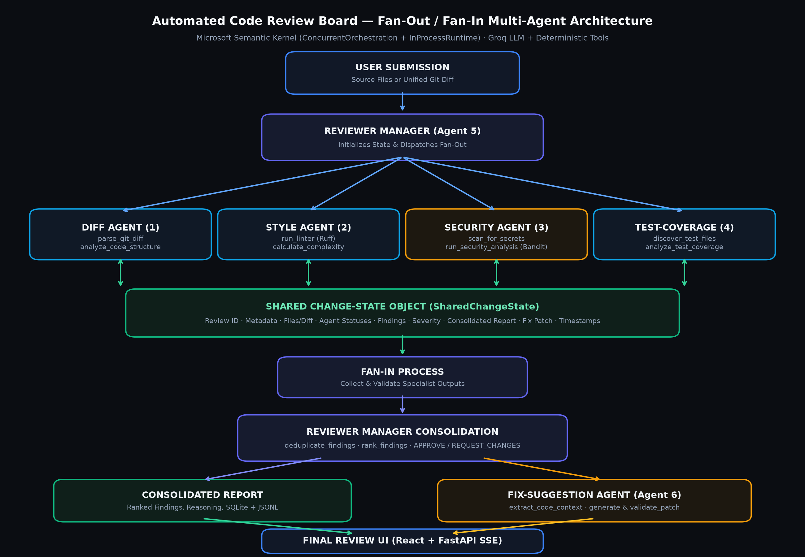

# Automated Code Review Board
## CSE476: Agentic AI and Intelligent Automation — Group 14 Project

An intelligent, multi-agent code review and fix-recommendation platform built with **FastAPI**, **Microsoft Semantic Kernel**, **Groq LLM** (with resilient Demo Mode fallback), **SQLite**, and a **React + TypeScript + Tailwind CSS** dark developer dashboard.



---

## 1. Project Overview

The **Automated Code Review Board** ingests source code changes (either multi-file source uploads or unified Git diffs), distributes the review workload across specialized AI agents in parallel, deduplicates and ranks findings by severity, and issues an executive merge recommendation (`APPROVE` or `REQUEST_CHANGES`). For Group 14 (group-of-three requirement), a dedicated **Fix-Suggestion Agent** proposes a concretely validated, unified diff patch for the single highest-severity finding, strictly gated behind human-in-the-loop approval.

---

## 2. Six-Agent Architecture & Python Tools

Every agent is implemented in an independent Python module and invokes real deterministic static-analysis and AST tools:

| Agent | Module | Responsibilities & Tools Invoked (`@kernel_function`) |
|---|---|---|
| **Diff Agent (1)** | [`backend/agents/diff_agent.py`](./backend/agents/diff_agent.py) | Parses unified Git diffs, categorizes added/modified/deleted files, inspects AST structures, flags risky functions. Tools: `parse_git_diff()`, `extract_modified_files()`, `analyze_code_structure()`. |
| **Style Agent (2)** | [`backend/agents/style_agent.py`](./backend/agents/style_agent.py) | Enforces PEP 8 / JS conventions, function length, docstring presence, cyclomatic complexity (Radon), and code duplication. Tools: `run_linter()` (Ruff + AST checks), `calculate_complexity()`. |
| **Security Agent (3)** | [`backend/agents/security_agent.py`](./backend/agents/security_agent.py) | Scans for hardcoded credentials (with automatic secret redaction), SQL injection patterns, `shell=True`, `eval()`, weak hashing, and Bandit static issues. Tools: `scan_for_secrets()`, `run_security_analysis()` (Bandit). |
| **Test-Coverage Agent (4)** | [`backend/agents/test_coverage_agent.py`](./backend/agents/test_coverage_agent.py) | Discovers test files, maps production symbols to test suites, evaluates test coverage, and suggests missing test scenarios. Tools: `discover_test_files()`, `analyze_test_coverage()`. |
| **Reviewer Manager (5)** | [`backend/agents/reviewer_manager.py`](./backend/agents/reviewer_manager.py) | Central orchestrator. Collects specialist outputs via fan-in, merges duplicate findings across agents, sorts by severity (`CRITICAL`, `HIGH`, `MEDIUM`, `LOW`, `INFO`), and issues final merge recommendation with reasoning. Tools: `deduplicate_findings()`, `rank_findings()`, `generate_review_report()`. |
| **Fix-Suggestion Agent (6)** | [`backend/agents/fix_suggestion_agent.py`](./backend/agents/fix_suggestion_agent.py) | Selects the highest-severity actionable finding, extracts surrounding code context, proposes a minimal fix, generates a unified diff patch, and statically validates syntax without executing code. Tools: `extract_code_context()`, `generate_unified_patch()`, `validate_patch()`. |

---

## 3. Orchestration & Shared Memory

- **Multi-Agent Framework:** Built on **Microsoft Semantic Kernel** (`semantic-kernel` 1.47+) using `ConcurrentOrchestration` and `InProcessRuntime`.
- **Shared Change State:** All agents read from and mutate a thread/async-safe [`SharedChangeState`](./backend/orchestration/state.py) object containing:
  - Unique `review_id` and submission metadata (title, description, language, mode)
  - Raw and reconstructed file records
  - Real-time agent statuses (`pending`, `running`, `completed`, `failed`), activities, timestamps, and tool names
  - Individual agent findings and structured outputs
  - Deduplicated and ranked findings with severity counts
  - Merge recommendation (`decision`, `reasoning`, `decision_factors`)
  - Statically validated fix patch and explicit user approval flag
  - Append-only event trace (`backend/logs/review_runs.jsonl`)

---

## 4. Safety & Failure Resilience

1. **Untrusted Code Execution Prevention:** Submitted code and generated patches are **never** executed. Linters and analyzers run purely via static parsing (AST, Ruff JSON, Bandit JSON).
2. **Secret Redaction:** Discovered credentials (API keys, tokens, passwords) are automatically masked (`gsk_************def`) before appearing in reports, UI streams, SQLite, or log files.
3. **Agent Failure Handling:** If an individual agent times out or fails, `SharedChangeState.mark_agent_failed()` marks that agent as `failed` while allowing other agents to complete. The Reviewer Manager explicitly notes the failure in `decision_factors` and will **never** claim an unexecuted check passed. If the Security Agent fails, the manager automatically enforces `REQUEST_CHANGES`.
4. **Resilient LLM & Demo Mode:** If `GROQ_API_KEY` is not provided or rate limits are reached, the platform falls back to `MockGroqChatCompletion`, allowing full end-to-end evaluation without third-party API dependencies.
5. **Human-in-the-Loop Patch Gate:** Patches cannot be downloaded (`403 Forbidden`) until the user explicitly clicks `Approve Patch for Download` in the UI or invokes `POST /api/reviews/{id}/patch/approve`.

---

## 5. Quickstart & Local Execution

### Backend
```powershell
cd backend
python -m venv .venv
.venv\Scripts\activate
pip install -r requirements.txt
# Copy example env (works out-of-the-box in Demo Mode without API key)
copy .env.example .env
uvicorn main:app --host 127.0.0.1 --port 8000 --reload
```
API Documentation: `http://127.0.0.1:8000/docs`

### Frontend
```powershell
cd frontend
npm install
npm run dev
```
Developer Dashboard: `http://localhost:5173`

### Tests
```powershell
cd backend
pytest tests -v
```

### Runnable Jupyter Demo Notebook
```powershell
cd backend
.venv\Scripts\python.exe -m jupyter notebook ../automated_code_review_demo.ipynb
```

---

## 6. Project Layout

```
.
├── automated_code_review_demo.ipynb    # Fully executed end-to-end demo notebook
├── backend/
│   ├── main.py                         # FastAPI REST, SSE & WebSocket API
│   ├── requirements.txt                # Python dependencies (semantic-kernel, ruff, bandit, etc.)
│   ├── pytest.ini                      # Pytest asyncio configuration
│   ├── .env.example                    # Environment template (Groq API, SQLite, safety limits)
│   ├── agents/                         # 6 independent agent modules
│   ├── orchestration/                  # Semantic Kernel ConcurrentOrchestration & SharedChangeState
│   ├── tools/                          # 12 real Python static & AST analysis tools
│   ├── services/                       # LLM service, file validator, log manager, review runner
│   ├── database/                       # SQLAlchemy models & SQLite review history store
│   ├── tests/                          # 7 test cases (Clean, Vulnerable, Mixed, Failure, API)
│   └── logs/review_runs.jsonl          # Append-only structured execution audit log
├── frontend/
│   ├── src/pages/                      # Dashboard, New Review, Live Trace, Results, Patch, History
│   ├── src/components/                 # Agent status cards, severity badges
│   ├── src/services/api.ts             # Typed REST API client
│   └── src/hooks/useReviewStream.ts    # Real-time SSE / WebSocket event consumer
└── docs/
    ├── README.md                       # Academic project overview & rubric mapping
    ├── architecture.md                 # Detailed architecture specification
    └── architecture_diagram.png        # High-resolution architectural diagram
```

