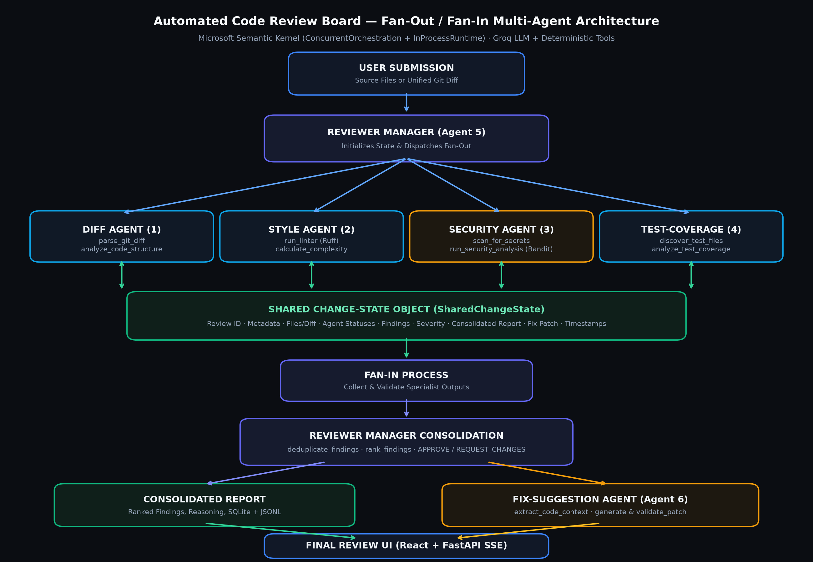

# Architecture — Automated Code Review Board

## 1. Fan-Out / Fan-In Multi-Agent Topology

The platform is orchestrated using **Microsoft Semantic Kernel** (`semantic-kernel`) with `ConcurrentOrchestration`, `InProcessRuntime`, `ChatCompletionAgent`, and `@kernel_function` tool plugins:

1. **User Submission**: Accepts source files (`.py`, `.js`, `.jsx`, `.ts`, `.tsx`, `.java`, `.cpp`, `.c`, `.go`) or unified Git diffs via FastAPI (`POST /api/reviews`).
2. **Initialization**: `SharedChangeState` is instantiated with a `review_id`, sanitized files/diff, pending statuses for all six agents, and an append-only JSONL event sink (`backend/logs/review_runs.jsonl`).
3. **Fan-Out (Parallel Execution)**: The Reviewer Manager dispatches four specialist `StateAwareSKAgent` instances simultaneously over `InProcessRuntime` via `ConcurrentOrchestration`:
   - **Diff Agent** (`backend/agents/diff_agent.py`)
   - **Style Agent** (`backend/agents/style_agent.py`)
   - **Security Agent** (`backend/agents/security_agent.py`)
   - **Test-Coverage Agent** (`backend/agents/test_coverage_agent.py`)
4. **Shared Change State**: Every agent reads submission data and writes its status, invoked tools, findings, and structured outputs under an async lock, broadcasting real-time SSE/WebSocket updates to the React UI.
5. **Fan-In & Consolidation**: Once `ConcurrentOrchestration` finishes, **Reviewer Manager** (`backend/agents/reviewer_manager.py`) validates specialist results, runs `deduplicate_findings()` and `rank_findings()`, and emits `APPROVE` or `REQUEST_CHANGES` with evidence-backed reasoning.
6. **Fix-Suggestion Agent** (`backend/agents/fix_suggestion_agent.py`): Selects the single highest-severity actionable finding, extracts surrounding code context, generates a unified diff patch, validates syntax statically (`ast.parse` + diff structure), and gates download behind explicit user approval.

## 2. Deterministic-First Safety Model

- **Zero Code Execution**: Uploaded code and generated patches are never executed or imported. Ruff and Bandit run purely statically inside isolated temporary directories.
- **Secret Redaction**: Any credential matched by `secret_scanner.py` is masked (`gsk_************def`) before entering findings, patches, UI responses, SQLite, or JSONL logs.
- **Human-in-the-Loop Patch Gate**: `GET /api/reviews/{id}/patch/download` returns HTTP `403` until `POST /api/reviews/{id}/patch/approve` records explicit user consent.

